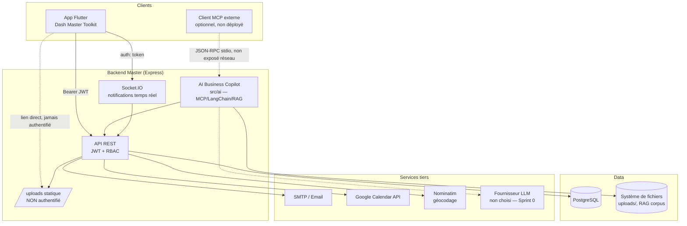

# Threat_Model.md — CRM CBI Tunisia + AI Business Copilot

## 1. Vue d'ensemble du système

## 2. Acteurs et rôles (RBAC)

| Rôle | Portée typique | Remarque sécurité |
|---|---|---|
| `superadmin`, `superadmin2`, `admin` | Accès complet — bypass les vérifications de propriété (`ADMIN_ROLES`) | Comptes les plus sensibles — voir §1 de `Security_Report.md` (mots de passe exposés) |
| `responsable_logistique_achat` | Portée restreinte à ses propres enregistrements (industrial-records, POR PROMESH, maintenance historique) | Seul rôle explicitement restreint par `moduleAccessGuard.js` — tous les autres rôles n'ont **aucune** restriction de préfixe de route à ce niveau (s'appuient entièrement sur `authRequired`/`requireRole` en aval) |
| `commercial` | Contacts commerciaux, KPI personnels | Fuite documentée : peut consulter le KPI d'un autre commercial via `?commercialName=` (§5.5 du rapport) |
| `user` (par défaut) | Projets dont il est propriétaire, ses propres demandes | Le contrôle de propriété n'était pas uniforme avant cet audit (voir §4.3 du rapport) |
| Compte "gestionnaire maintenance" (e-mail codé en dur) | Gestion complète des demandes de maintenance | Modèle hybride rôle-OU-email, cohérent dans tout le CRM (`isMaintenanceManager`) |
| Client MCP externe (module IA) | Agit **toujours** au nom d'un `actingUser` CRM réel, jamais avec des privilèges élevés propres | Le kernel IA ne réimplémente jamais l'autorisation — délègue systématiquement à `PermissionManager`/aux services CRM existants |

## 3. Surfaces d'entrée (attack surface)

| Surface | Authentifiée ? | Limitée en débit ? | Statut après cet audit |
|---|---|---|---|
| `POST /auth/signin`, `/forgot-password`, `/mfa/*` | Non (par nature) | Oui | Inchangé, déjà solide |
| La quasi-totalité des routes `/projects`, `/hr-requests`, `/maintenance-requests`, `/por-promesh`, `/industrial-records`, `/commercial-contacts`, `/admin`, `/users`, `/notifications` (hors `send-email`) | Oui | **Non**, sauf `/auth` et `/ai-dashboard` | Non modifié dans ce passage (hors périmètre — voir §7 du rapport) |
| `POST /api/clients/import-csv`, `/import-factures` | **Était non, désormais oui + rôle** | **Était non, désormais oui** | **Corrigé** |
| `POST /notifications/send-email` | **Était non, désormais oui** | Non | **Partiellement corrigé** |
| `GET /utils/geocode` | **Était non, désormais oui** | **Était non, désormais oui** | **Corrigé** |
| `GET /uploads/*` (fichiers HR/maintenance/POR PROMESH/devis/bons de commande) | **Non — inchangé** | Non | **Non corrigé** — voir §7 du rapport (nécessite coordination client Flutter) |
| Socket.IO (`/socket.io`) | **Était non, désormais oui (serveur)** | N/A | **Corrigé côté serveur**, client Flutter à mettre à jour |
| `PUT /pipeline/projects/:id/stage`, `/projects/:projectId/actions/:id`, `POST /maintenance-requests/:id/comments` | Oui, mais **sans contrôle de propriété** | N/A | **Corrigé** |
| Module IA — `GET /ai-dashboard*` | Oui | Oui (IP) + Oui (par utilisateur/outil, désormais par défaut) | **Corrigé** (passe précédente) |
| Module IA — serveur MCP stdio | N/A (process local, pas de réseau) | N/A | Hors surface réseau |

## 4. Actifs sensibles et leur exposition

| Actif | Où | Exposition résiduelle après correctifs |
|---|---|---|
| Secrets (DB, SMTP, JWT, OAuth Google) | `.env` (réel), anciennement aussi `.env.example` (commité) | **Critique — rotation externe requise**, voir §1 du rapport |
| Mots de passe utilisateurs | `bcrypt` coût 12, DB PostgreSQL | Sain |
| Pièces jointes (HR, maintenance, POR PROMESH, devis, bons de commande) | `uploads/` servi statique, sans auth | **Résiduel — URL non devinable mais permanente, aucune trace d'accès** |
| Refresh tokens | Cookie httpOnly, `sameSite: lax`, hashé (bcrypt) en base | Pas de rotation/détection de vol — résiduel documenté |
| Données de projets (montants, marges) | `list_projects` (Tool IA) et route HTTP équivalente | Visible par tout rôle autorisé au module — résiduel documenté, décision produit |
| Documentation RAG (jamais de données métier par construction, vérifié mécaniquement) | `src/ai/rag/` | Sain — contournement symlink corrigé |

## 5. Risques résiduels priorisés (ce qui reste à traiter, par ordre de priorité)

1. **Rotation des secrets exposés** (§1 du rapport) — priorité absolue, hors périmètre technique.
2. **Téléchargement non authentifié des pièces jointes** (`/uploads/*`) — nécessite soit (a) un contrôleur de téléchargement authentifié + mise à jour du client Flutter pour envoyer un header `Authorization` sur ces requêtes, soit (b) des URLs signées à durée limitée. Changement de comportement client non trivial, non entrepris ici.
3. **Rotation/détection de réutilisation des refresh tokens** — implémenter un modèle "token family" (jti + génération), révocation en cascade si un token déjà utilisé est rejoué.
4. **Décision produit sur la portée `list_projects`/KPI personnel** — actuellement org-wide pour tout rôle autorisé au module, potentiellement intentionnel.
5. **Rate limiting systématique** — étendre `express-rate-limit` à toutes les routes authentifiées coûteuses (exports Excel/PDF, recherche), pas seulement les 3 corrigées dans ce passage.
6. **Client Flutter** — mise à jour pour l'authentification Socket.IO (`auth: { token }`), sans quoi les notifications temps réel restent indisponibles après ce correctif.

## 6. Zones non exhaustivement auditées (à couvrir dans une prochaine passe)

- L'ensemble des migrations SQL (inspection par sondage seulement).
- Race conditions sur les écritures concurrentes (ex. double-validation d'une même fiche POR PROMESH depuis deux sessions).
- Sécurité du webhook Google Calendar entrant (validation de signature des notifications push).
- Audit ligne à ligne du code Dart du client Flutter (secrets embarqués, stockage du token, épinglage de certificat).
- L'intégralité des ~40 fichiers de routes/contrôleurs non explicitement cités dans `Security_Report.md` — l'audit a priorisé les surfaces à plus fort impact (endpoints non authentifiés, IDOR, injection) plutôt qu'une revue exhaustive fichier par fichier de chaque module CRM.
