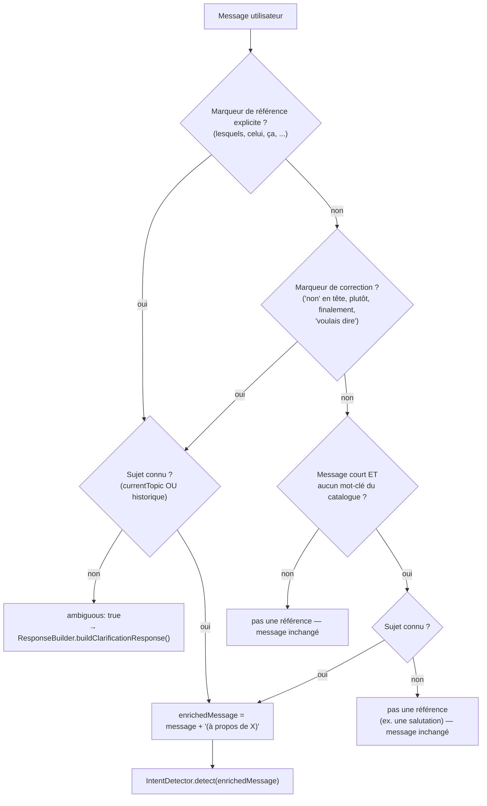

# Natural Conversation Engine — références, reformulations, conversations longues, ambiguïtés

Ce document décrit comment le Copilot comprend qu'un message court comme « Et lesquels sont en retard ? » se rapporte à ce qui vient d'être affiché, qu'une correction ("Non, plutôt...") porte sur la même demande, et que le sujet d'une conversation reste connu même après des dizaines de tours — sans qu'aucun fournisseur LLM ne soit requis pour cela. Deux points d'entrée : `ConversationContextResolver.resolve({ message, history, currentTopic })` (`conversationContextResolver.js`) et `ConversationManager.getCurrentTopic(conversationId)` (`conversationManager.js`), tous deux consommés par `AIManager.handleMessage()` juste avant l'étape 2 (détection d'intention) du workflow en 12 étapes (voir `WORKFLOW.md`).

## L'exemple demandé

```
Utilisateur : Montre-moi les projets.
Assistant   : Voici les projets.               [intent: "projects"]
Utilisateur : Et lesquels sont en retard ?
```

Pris seul, « Et lesquels sont en retard ? » ne contient aucun mot-clé propre à l'intention `"projects"` autre que "retard" (qui, dans le catalogue réel, en fait déjà partie — voir la limite discutée plus bas). Le mécanisme décrit ici ne dépend pas de cette coïncidence : il reconnaît le pronom "lesquels" comme un **marqueur de référence**, retrouve le sujet du dernier tour assistant connu (`"projects"`), et enrichit le message avant de le transmettre à `IntentDetector`/`ToolRouter`, qui n'ont besoin d'aucune modification pour en tirer parti.



## Trois signaux, deux politiques d'ambiguïté

`ConversationContextResolver.resolve()` combine trois signaux distincts (voir le commentaire de classe dans `conversationContextResolver.js` pour le détail), chacun produisant un champ `signal` (`"reference"|"correction"|"ellipsis"|null`) dans le résultat, pour rester inspectable/testable :

1. **Marqueur de référence explicite** (`signal: "reference"`) — un pronom/déictique français qui ne peut grammaticalement renvoyer qu'à quelque chose déjà mentionné (`REFERENCE_MARKERS` : "lesquels", "lesquelles", "lequel", "laquelle", "celui", "celle", "ceux", "celles", "ça"/"ca", "cela"). **Signal fort** : sans sujet connu, c'est une vraie ambiguïté (`ambiguous: true`), jamais une supposition.
2. **Marqueur de correction/reformulation** (`signal: "correction"`) — l'utilisateur ne demande pas autre chose, il PRÉCISE ou CORRIGE ce qu'il vient de demander (`CORRECTION_MARKERS` : "plutôt"/"plutot", "finalement", "correction" ; plus deux vérifications structurelles : "non" en TÊTE de phrase seulement — jamais ailleurs, trop fréquent en français pour être fiable comme simple token, voir `REFERENCE_MARKERS` et sa même discipline sur "le"/"la"/"les" — et la locution "voulais dire"). **Même politique que le signal de référence** : signal fort, bloquant sans sujet connu (une correction en tout début de conversation ne corrige rien, une vraie ambiguïté).
3. **Reformulation elliptique** (`signal: "ellipsis"`) — un message court (`shortMessageMaxTokens`, 5 par défaut) qui ne matche aucun mot-clé d'aucune intention du catalogue (ex. "et les autres ?", "pourquoi ?"). **Signal faible** : sans sujet connu, ce n'est PAS signalé comme ambigu — cela peut légitimement être un message autonome (une salutation) qui doit simplement suivre son chemin normal (repli sur `general_chat`).

La distinction forte/faible a été ajoutée après qu'un test a révélé un faux positif réel : traiter les deux signaux de façon identique bloquait "bonjour, une question generale" derrière une demande de clarification injustifiée. Voir la section Tests.

## Ambiguïté : `mode: "clarification"`, jamais une hallucination

Quand le signal fort ne peut pas être résolu (première question d'une conversation, historique vide/effacé), `AIManager` ne devine pas et n'appelle ni `ToolRouter` ni `WorkflowManager` ni `AgentRouter` : il retourne directement `ResponseBuilder.buildClarificationResponse()`, un nouveau mode de réponse distinct de `mode: "error"` — ce n'est pas un échec du système, c'est un tour de conversation légitime. Le tour utilisateur est tout de même enregistré dans l'historique (`ConversationManager.recordUserMessage`) et audité (`outcome: "flagged"`, `reason: "ambiguous_reference"`), mais aucune réponse assistant n'est produite au sens habituel. Ce choix prolonge directement le principe anti-hallucination déjà posé dans `langchain/prompts/RESPONSE_PROMPTS.md` : mieux vaut demander une précision que fabriquer une réponse.

## Où le sujet résolu est stocké

Chaque tour assistant est déjà enregistré via `ConversationManager.recordAssistantMessage(conversationId, answer, { intent: intent.name, mode })` (appelé par `AIManager`). Deux façons de le relire coexistent, l'une héritée, l'autre nouvelle :

- **`ConversationContextResolver._lastKnownTopic(history)`** — relit `intent` sur le tour assistant le plus récent d'un `history` déjà chargé (fenêtré, voir ci-dessous) : jamais un tour utilisateur (qui n'en a pas), jamais une intention absente du catalogue courant, jamais `"general_chat"` (voir plus bas).
- **`ConversationManager.getCurrentTopic(conversationId)`** — une `Map<conversationId, intentKey>` séparée, mise à jour à CHAQUE tour assistant à intention connue, **indépendante de la fenêtre d'historique**. `AIManager` la passe à `resolve({..., currentTopic})`, qui la préfère à `_lastKnownTopic(history)` quand elle est fournie (repli sur l'historique sinon — les deux voies existent pour que le resolver reste testable en isolation).

## Conversations longues — le sujet ne s'efface jamais simplement parce que l'historique est fenêtré

`ConversationManager.getHistory()` reste TOUJOURS fenêtrée (`maxHistoryMessages`, 20 par défaut) — garder tout le texte d'une conversation indéfiniment n'aurait aucun sens (coût mémoire/tokens). Avant cette passe, `_lastKnownTopic(history)` relisait ce même historique fenêtré : si le tour qui avait établi le sujet ("projects") sortait de la fenêtre (une conversation de plus de 20 tours), la question suivante — même « Et lesquels sont en retard ? » — retombait dans le vide, `ambiguous: true`, alors que la conversation portait toujours, en réalité, sur les projets.

`getCurrentTopic()` corrige cela à coût quasi nul : suivre UN mot (une clé d'intention) par conversation, jamais purgé par la fenêtre, plutôt que de re-dériver le sujet en relisant du texte à chaque tour. Preuve par test bout-en-bout (`test/ai.conversation.naturalEngine.test.js`) : après 30 tours de bavardage générique avec une fenêtre d'historique réglée à 4 messages, une question sans AUCUN mot-clé de catalogue résout toujours vers "projects".

**`"general_chat"` n'est JAMAIS suivi comme un sujet** (`ConversationManager.recordAssistantMessage`/`ConversationContextResolver._lastKnownTopic`, même exclusion aux deux endroits) : c'est le repli délibéré "aucune intention métier précise identifiée" (voir `intentCatalog.js`), pas un sujet de conversation. Une digression générique ("merci", une salutation) au milieu d'un échange sur les projets ne doit pas faire OUBLIER ce sujet.

## Le mot-clé "retard" — un vrai angle mort découvert et corrigé dans cette passe

L'exemple canonique fonctionnait déjà pour le ROUTAGE (le message enrichi atteint bien `ProjectAgent`), mais pas jusqu'au bout : `ProjectAgent._looksLikeAttentionQuery()` (voir `agents/projectAgent.js`) déclenche le VRAI classement par attention (`ProjectAttentionAnalyzer`) seulement si le message contient un marqueur de `ATTENTION_MARKERS` — une liste LOCALE à cet Agent, distincte du catalogue d'intentions global. Cette liste ne contenait ni "retard" ni "retards", alors que le retard est la toute PREMIÈRE dimension notée par l'analyseur (voir `BUSINESS_REASONING.md`) — un angle mort entre deux passes antérieures de ce projet (le resolver de contexte et le raisonnement métier de `ProjectAgent`), jamais remarqué faute d'un test bout-en-bout qui exécute l'exemple exact avec de VRAIS collaborateurs (voir Tests). Corrigé en ajoutant "retard"/"retards" à `ATTENTION_MARKERS` — jamais dans le resolver lui-même, qui ne connaît (et ne doit connaître) rien du vocabulaire métier propre à un Agent particulier.

## Où l'enrichissement est injecté — et où il ne l'est pas

Le message enrichi (`enrichedMessage`, ex. `"Et lesquels sont en retard ? (à propos de projet)"`) remplace le message d'origine pour **toute la suite du traitement interne** de ce tour : `IntentDetector.detect()`, `ToolRouter.select()`, `AgentRouter`/`Agent.execute()`, `WorkflowManager.run()`. Il n'est en revanche **jamais persisté** : `ConversationManager.recordUserMessage()` enregistre toujours le message tel que l'utilisateur l'a réellement tapé — l'historique de conversation reste fidèle à ce qui a été dit, l'enrichissement n'est qu'un artefact interne de résolution.

## Câblage (`pipeline.js`)

Contrairement à la plupart des autres collaborateurs optionnels de ce kernel (qui par défaut valent `null`/désactivé), la résolution de contexte est **activée par défaut** dans `createAiOrchestrator()` (`enableContextResolution: true`), construite avec le même `intentCatalog` que le reste du pipeline. Justification : il s'agit d'une capacité explicitement demandée comme requirement ("Le Copilot doit mémoriser le contexte"), et le mécanisme est conçu pour être à faible risque — il ne s'active que sur un signal explicite (marqueur de référence ou message court/non reconnu) et ne fait rien d'autre autrement. `contextResolver` (une instance explicite) prend le pas si fourni ; `enableContextResolution: false` restaure le comportement d'avant cette fonctionnalité. `AIManager` lui-même garde `contextResolver = null` par défaut dans son propre constructeur — la décision d'activer par défaut est de la responsabilité de la racine de composition (`pipeline.js`), pas du composant lui-même.

## Limite connue — et assumée

Le mot-clé "retard" fait partie des mots-clés du catalogue pour l'intention `"projects"` (`intentCatalog.js`) — ce qui signifie que, pour l'exemple canonique précis, le ROUTAGE réussirait même sans résolution de contexte, par simple recouvrement lexical (`test/ai.orchestrator.conversationContextResolver.test.js` utilise un catalogue de test simplifié pour rester focalisé sur le mécanisme lui-même, indépendamment de cette coïncidence). Le mécanisme reste néanmoins nécessaire pour le cas général : toute reformulation qui ne recycle aucun mot-clé du sujet précédent (« Et les autres ? », « Depuis quand ? », « Et lesquels nécessitent une attention ? » — "attention" n'est mot-clé d'AUCUNE intention du catalogue global, seulement un marqueur local à `ProjectAgent`) resterait sinon mal classée. `test/ai.conversation.naturalEngine.test.js` le prouve avec le VRAI catalogue ET une question qui ne recycle aucun mot-clé global — la preuve la plus forte possible que ce n'est pas une coïncidence lexicale qui fait fonctionner l'exemple.

## Ce qui n'a pas été fait (délibérément)

- **Pas de résolution multi-sujets** : un seul "sujet courant" (le dernier tour assistant à intention connue et distincte de `"general_chat"`) est suivi ; un message qui ferait référence à un sujet plus ancien qu'un sujet intermédiaire ("non, je parlais des CONGÉS, pas des projets", où "congés" ÉTAIT bien un vrai sujet distinct entre-temps) n'est pas désambiguïsé plus finement — hors périmètre de la demande.
- **Pas d'apprentissage / pas de LLM** : entièrement à base de règles (comme `LexicalIntentRouter`/`IntentClassifier`), cohérent avec la philosophie "aucun fournisseur LLM requis pour être testable" du reste du kernel (Sprint 0). Les "corrections/reformulations" traitées ici (`CORRECTION_MARKERS`) sont donc uniquement lexicales — une reformulation qui ne contient AUCUN de ces mots ni une référence pronominale ni un message court reste hors de portée, jamais devinée.
- **`le`/`la`/`les`/`il`/`elle`/`en`/"oui"/"non" (hors tête de phrase) volontairement EXCLUS** des listes de marqueurs malgré leur usage pronominal/conversationnel possible en français : ce sont aussi des mots extrêmement fréquents dans d'autres rôles grammaticaux, les inclure sans restriction produirait un faux positif sur presque n'importe quelle phrase.
- **Pas de désambiguïsation des égalités de score entre deux intentions** (`LexicalIntentRouter`, la première intention enregistrée gagne silencieusement en cas d'égalité) — un mécanisme distinct, plus risqué à modifier globalement (des mots-clés d'intentions entières ont été délibérément calibrés, phase après phase, en s'appuyant sur cet ordre de départage) ; hors périmètre de cette passe, qui reste concentrée sur le resolver de contexte.

## Tests

- `test/ai.orchestrator.conversationContextResolver.test.js` (29 tests) : l'exemple demandé, ordre/filtrage de l'historique (tour assistant le plus récent, ignore les tours utilisateur, ignore une intention disparue du catalogue ou `"general_chat"`, historique vide), ambiguïté pour chacun des marqueurs testés sans sujet connu (référence ET correction), corrections/reformulations ("plutôt"/"finalement", "non" en tête de phrase seulement, la locution "voulais dire"), reformulations elliptiques (résolues silencieusement avec sujet, jamais ambiguës sans sujet — re-teste explicitement le faux positif corrigé sur une salutation), `currentTopic` (priorité sur l'historique, ignoré si absent du catalogue, repli sur l'historique par défaut), aucune référence du tout, configuration (`shortMessageMaxTokens`, `referenceMarkers` personnalisés).
- `test/ai.orchestrator.conversationManager.test.js` : `getCurrentTopic` (mise à jour à chaque tour à intention connue, `"general_chat"` explicitement ignoré, portée par conversation, survit à une fenêtre d'historique minuscule après 30 tours, oublié par `reset()`).
- `test/ai.agents.projectAgent.test.js` : "retard"/"retards" déclenchent bien `_runAttentionAnalysis`, plus un test dédié avec le message EXACT tel qu'il atteint l'Agent après enrichissement par le resolver.
- `test/ai.orchestrator.responseBuilder.test.js` : forme et contenu de `buildClarificationResponse()`.
- `test/ai.orchestrator.aiManager.test.js` : intégration avec un `IntentDetector` FACTICE (isole le mécanisme de résolution lui-même) — l'exemple exact, l'ambiguïté en tout début de conversation, la rétrocompatibilité par défaut.
- `test/ai.conversation.naturalEngine.test.js` (nouveau, 5 tests) : bout-en-bout avec le VRAI `IntentDetector`/catalogue/`ProjectAgent` — la seule suite qui prouve que l'exemple canonique produit une VRAIE réponse métier ("voici les projets en retard", pas seulement un routage correct), qu'une résolution de contexte est réellement NÉCESSAIRE (message sans aucun mot-clé de catalogue), qu'une correction produit le même résultat métier réel, qu'une correction sans sujet antérieur est refusée poliment, et que le sujet survit à 30 tours de bavardage générique avec une fenêtre d'historique volontairement minuscule.

Trois bugs réels ont été découverts et corrigés via ces tests (pas des bugs de test) :
1. Un faux positif d'ambiguïté sur une salutation générique (voir plus haut, section "Trois signaux").
2. Des marqueurs avec trait d'union (`"celui-ci"`, `"celle-là"`, ...) qui ne pouvaient jamais matcher : `utils/tokenize.js` découpe sur le trait d'union, donc `"celui-ci"` devient deux tokens (`"celui"`, `"ci"`) et ne matche jamais le token entier `"celui-ci"`. Corrigé en gardant seulement les racines ("celui"/"celle"/"ceux"/"celles"), aussi distinctives seules.
3. **"retard"/"retards" absents de `ATTENTION_MARKERS`** (`agents/projectAgent.js`) — l'exemple canonique routait déjà correctement vers `ProjectAgent` mais n'y déclenchait pas le VRAI classement par attention ; découvert seulement en écrivant un test bout-en-bout avec de VRAIS collaborateurs (`test/ai.conversation.naturalEngine.test.js`), invisible dans les tests précédents qui utilisaient tous un `IntentDetector`/`ProjectAgent` factice ou des messages différents. Voir "Le mot-clé 'retard'" plus haut.
