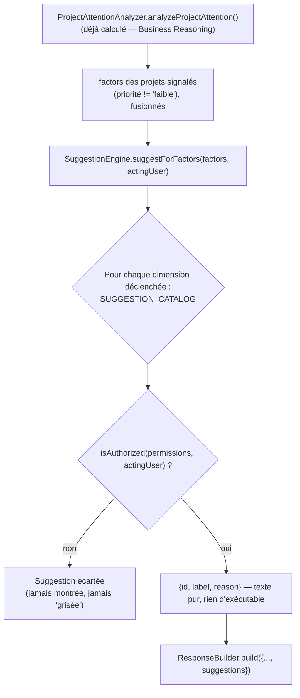

# Smart Suggestions — le Copilot propose, il n'exécute jamais

Ce document décrit comment le Copilot répond à un projet en retard non seulement par un constat, mais par une liste d'actions concrètes qu'il PEUT proposer — jamais qu'il exécute. Point d'entrée : `SuggestionEngine.suggestForFactors(factors, actingUser)` (`orchestrator/suggestionEngine.js`), catalogue des actions dans `orchestrator/suggestionCatalog.js`, déclenché depuis `agents/projectAgent.js`.

## L'exemple demandé

```
Projet en retard.
  ↓
Suggestions :
  - Créer une activité.
  - Préparer un email.
  - Programmer une réunion.
  - Créer un rappel.
```

Ce mapping exact (`retard` → ces 4 actions) est câblé tel quel dans `DIMENSION_SUGGESTION_TRIGGERS.retard` (`suggestionCatalog.js`) — aucune approximation.

## Où ça se déclenche

`SuggestionEngine` réutilise directement la sortie de `ProjectAttentionAnalyzer` (voir `reasoning/BUSINESS_REASONING.md`, Phase précédente) : quand `ProjectAgent` répond à une question d'attention/priorité/risque, il calcule déjà, pour chaque projet, une liste de `factors` (les raisons exactes qui l'ont fait remonter — retard, budget, activité, échéances, pipeline, blocages). Ces MÊMES `factors`, pour tous les projets dont la priorité n'est pas `"faible"`, sont transmis à `SuggestionEngine.suggestForFactors()`.



**Portée assumée de cette passe** : seul `ProjectAgent`, sur son chemin d'analyse d'attention (Phase précédente), produit des suggestions aujourd'hui. `ResponseBuilder`/`AIManager` savent transporter un champ `suggestions` pour N'IMPORTE QUEL Agent/Workflow (`suggestions = []` par défaut, additif, non-cassant), mais aucun autre Agent ne le renseigne encore — une extension possible, pas encore faite, documentée ici plutôt que fabriquée.

## Le catalogue — une action, une seule source de vérité pour sa permission

| Action (`id`) | Libellé | Source de la permission |
|---|---|---|
| `create_activity` | Créer une activité | **Résolue dynamiquement depuis le vrai Tool MCP `create_project_action`** (`mcp/tools/projectActions/`, ajouté lors du développement de l'Automation Agent — voir `AUTOMATION_WORKFLOWS.md`) via `toolPermissionIndex` — jamais dupliquée dans le catalogue. |
| `prepare_email` | Préparer un email | Déclarée dans le catalogue, ouverte (`[]`) — "préparer" n'est l'exécution d'aucune route existante, donc aucune règle réelle à répliquer ; ouvrir à tout utilisateur authentifié est le choix le moins arbitraire. |
| `schedule_meeting` | Programmer une réunion | **Résolue dynamiquement depuis le vrai Tool MCP `create_calendar_event`** (`mcp/tools/googleCalendar/`) via `toolPermissionIndex` — jamais dupliquée dans le catalogue. |
| `create_reminder` | Créer un rappel | **Résolue dynamiquement depuis le même Tool MCP `create_project_action`** — dans ce CRM, un rappel n'est jamais un enregistrement indépendant, toujours l'attribut `dateRelance` d'une activité (voir `modules/project-actions/services/projectAction.service.js::createAction`). |
| `notify_team` | Notifier l'équipe | **Résolue dynamiquement depuis le vrai Tool MCP `send_notification_email`** (`mcp/tools/notifications/`) — `requiredRoles: ["admin","superadmin","superadmin2"]`. Seule action réellement restreinte du catalogue par défaut — la démonstration concrète que le filtrage par permission fonctionne (voir Tests). |

`toolPermissionIndex` (`orchestrator/pipeline.js::buildToolPermissionIndex()`) est construit UNE FOIS, en lisant les VRAIS Tools MCP (même manifeste `mcp/tools/index.js` que `buildToolModuleIndex()`, déjà utilisé par `ToolRouter`) — jamais une seconde copie de `requiredRoles` qui pourrait dériver de la vraie règle du Tool.

## Le mapping dimension → actions

| Dimension (voir `BUSINESS_REASONING.md`) | Actions suggérées | Justification |
|---|---|---|
| `retard` | `create_activity`, `prepare_email`, `schedule_meeting`, `create_reminder` | L'exemple demandé, tel quel. |
| `echeance` | `schedule_meeting`, `create_reminder` | Une échéance qui approche ou est dépassée appelle un point (réunion) et un suivi (rappel). |
| `blocage` | `create_activity`, `notify_team` | Débloquer par une nouvelle activité ; escalader si nécessaire. |
| `pipeline` | `create_activity` | Un projet sans étape ou bloqué a besoin d'une action pour avancer. |
| `activite` | `create_activity`, `prepare_email` | Aucune mise à jour récente : relancer par une activité ou un email. |
| `budget` | `prepare_email`, `notify_team` | Un souci budgétaire se traite en communiquant (client) ou en alertant (équipe). |

Au-delà de `retard` (l'exemple exact), les 5 autres mappings sont une extension raisonnable, pas une exigence littérale — documentée ici pour rester auditable.

## Les trois garanties demandées

1. **Toutes les suggestions respectent les permissions de l'utilisateur.** `SuggestionEngine.suggestForFactors()` appelle `isAuthorized()` (`utils/authorization.js` — le MÊME prédicat que `PermissionManager`/`BaseAgent`) pour CHAQUE candidat, AVANT de l'inclure. Une action refusée n'apparaît PAS dans la liste — pas de champ `disabled`, pas de suggestion "grisée" : l'utilisateur ne voit jamais l'existence d'une capacité qui lui est refusée, même principe que `ToolRouter`/`AgentRouter`.
2. **Aucune action n'est exécutée automatiquement.** `SuggestionEngine` ne détient ni n'appelle AUCUN Tool exécutable — il renvoie exclusivement des objets `{id, label, reason}` (texte pur). Il n'existe structurellement aucun chemin de code, dans ce module ou dans `ProjectAgent`, qui invoque un Tool à partir d'une suggestion : produire une suggestion et exécuter une action sont deux capacités disjointes, la seconde n'étant même pas accessible depuis ce fichier.
3. **Créer les tests** — voir plus bas.

## Ce qui n'a pas été fait (délibérément)

- **Pas de suggestions par projet** : une seule liste, fusionnée sur tous les projets signalés d'une réponse — une simplification assumée (voir "Portée assumée" plus haut), pas une granularité par projet.
- ~~Pas de nouveaux Tools MCP créés pour combler `create_activity`/`create_reminder`~~ — **comblé** lors du développement de l'Automation Agent (`create_project_action`, voir `AUTOMATION_WORKFLOWS.md`) : les deux actions sont désormais résolues dynamiquement comme `schedule_meeting`/`notify_team`, plus aucune permission codée en dur dans le catalogue pour elles.
- **Pas de suggestions en dehors du chemin d'analyse d'attention** : une question ordinaire ("Montre-moi les projets") ne produit aucune suggestion aujourd'hui, même si le mécanisme de transport (`ResponseBuilder`/`AIManager`) est générique.

## Tests

- `test/ai.orchestrator.suggestionEngine.test.js` : chaque dimension isolément, dédoublonnage (une action déclenchée par 2 dimensions n'apparaît qu'une fois), filtrage par permission (ouvert vs. `notify_team` admin-tier — accepté pour un admin, écarté pour un `user`), un candidat sans entrée catalogue ne casse rien, et — la garantie n°2 — vérifie qu'AUCUN objet renvoyé ne porte de fonction/callback exécutable.
- `test/ai.agents.projectAgent.test.js` : les suggestions n'apparaissent que sur le chemin d'analyse d'attention, sont bien filtrées par le rôle de l'utilisateur courant (un `user` ne voit jamais `notify_team`, un `admin` le voit), et sont absentes (`[]`) sans `suggestionEngine` injecté — rétrocompatible.
- `test/ai.orchestrator.responseBuilder.test.js` : le champ `suggestions` est projeté tel quel dans l'enveloppe de réponse, `[]` par défaut sur les 3 modes (`build`/`buildErrorResponse`/`buildClarificationResponse`).
- `test/ai.orchestrator.aiManager.test.js` : `agentResult.suggestions` atteint bien la réponse finale.
- `test/ai.orchestrator.pipeline.test.js` : `buildToolPermissionIndex()` reflète les vrais `requiredRoles` des Tools MCP, et `suggestionEngine` est bien transmis aux Agents.
