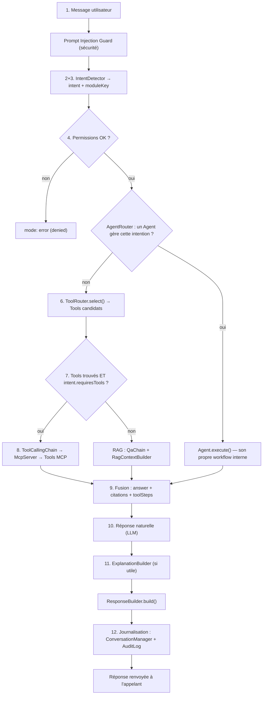

# Le cerveau du Copilot — workflow en 12 étapes

Ce document décrit, étape par étape, ce qui se passe entre la réception d'un message utilisateur et l'envoi d'une réponse. Chaque étape renvoie au fichier réel qui l'implémente. Point d'entrée unique : `AIManager.handleMessage({ message, user, conversationId })` (`aiManager.js`).

Le système est **entièrement modulaire** : `AIManager` ne construit aucun de ses collaborateurs lui-même (Dependency Injection stricte) — chacun des composants ci-dessous est substituable indépendamment (un faux `IntentDetector` dans les tests, un vrai `LexicalIntentRouter` ou un futur `LlmIntentRouter` en production, sans changer une ligne d'`AIManager`). Voir `pipeline.js::createAiOrchestrator()` pour le câblage par défaut.

---

## Étape 1 — Recevoir une question utilisateur

`AIManager.handleMessage({ message, user, conversationId })` (`aiManager.js:129`). Rejette un message vide (`OrchestratorError`) avant toute autre étape.

Avant tout traitement métier, le message brut passe par le `PromptInjectionGuard` (`security/promptInjectionGuard.js`, optionnel) — défense contre une tentative d'injection de prompt **directe** par l'utilisateur lui-même. Sans lui (défaut), le message n'est pas modifié.

## Étape 2 — Détecter automatiquement l'intention

`IntentDetector.detect(message, {user, conversationId})` (`intentDetector.js`). Délègue le choix d'une clé d'intention à un `IRouter` injecté — `LexicalIntentRouter` (offline, par mots-clés) par défaut, ou un `LlmIntentRouter` pour une classification plus flexible une fois un fournisseur LLM choisi. Résout ensuite cette clé contre `DEFAULT_INTENT_CATALOG` (`intentCatalog.js`) pour obtenir un objet `Intent` enrichi.

## Étape 3 — Identifier les modules métier concernés

Fait partie de la même résolution catalogue que l'étape 2 : chaque `Intent` porte un `moduleKey` (`"maintenance"`, `"hr"`, `"projects"`, ... ou `null` pour une question générale/documentaire). C'est ce `moduleKey` qui permet à `ToolRouter` (étape 6) de restreindre les Tools candidats au bon module métier — une frontière dure, jamais une suggestion.

## Étape 4 — Vérifier les permissions de l'utilisateur

**Ajouté lors de cette passe** (`aiManager.js`, juste après l'étape 2/3, AVANT toute construction de contexte ou sélection de Tool — échec rapide). Chaque `Intent` peut déclarer `requiredRoles`/`allowedEmails` (`intentCatalog.js`) ; s'il en déclare, `AIManager` appelle `utils/authorization.js::isAuthorized(...)` — **le même prédicat** déjà utilisé par `PermissionManager` (pour les Tools) et `BaseAgent` (pour les Agents), jamais une logique dupliquée. Une intention qui ne déclare aucune restriction (le cas de toutes les entrées du catalogue par défaut) reste ouverte à tout utilisateur authentifié, exactement comme avant cette passe.

En cas de refus : `OrchestratorPermissionError` levée, absorbée par le `catch` de `handleMessage()` → réponse `mode: "error"` normale (jamais une exception qui remonte à l'appelant), et journalisée `outcome: "denied"` (étape 12).

## Étape 5 — Construire le contexte métier

Deux sources, selon le chemin choisi plus bas :
- **Historique de conversation** : `ConversationManager.getHistory()` (`conversationManager.js`), lu par `RagContextBuilder`/`BaseAgent._historyText`.
- **Contexte documentaire (RAG)** : `RagContextBuilder` (`langchain/context/ragContextBuilder.js`) — récupère, guarde (anti-injection indirecte) et assemble les passages pertinents.

## Étape 6 — Décider si un AI Tool est nécessaire

`ToolRouter.select(intent, message)` (`toolRouter.js`). Ne renvoie une liste non vide QUE si `intent.requiresTools` est vrai. Filtre d'abord strictement par `moduleKey` (étape 3), puis classe les Tools candidats par recouvrement lexical avec le message, et ne garde que les `maxTools` premiers — un module comme "maintenance" en compte 15, on ne présente jamais tout au modèle.

## Étape 7 — Décider si une recherche RAG est nécessaire

`WorkflowManager.run()` (`workflowManager.js:50`) : si `intent.requiresTools` est vrai ET qu'au moins un Tool candidat a été trouvé (étape 6) → chemin Tool Calling (étape 8). **Sinon** → repli délibéré sur `qaChain` (RAG) — y compris quand aucun Tool pertinent n'a été trouvé pour une intention qui en demandait un : une dégradation gracieuse (tenter une réponse documentaire) plutôt qu'un échec sec, un choix de conception assumé (voir le test `"runs the qaChain when the intent requires tools but none were selected"`).

Le cas "un Agent a été sélectionné" (voir `AgentRouter`) court-circuite entièrement `WorkflowManager` : chaque Agent spécialisé possède son propre workflow interne (`BaseAgent._run()`), qui applique la même logique Tool-vs-RAG à son échelle.

## Étape 8 — Exécuter les AI Tools

`ToolCallingChain` (`langchain/chains/toolCallingChain.js`), construite par `WorkflowManager` ou l'Agent sélectionné, scopée aux Tools choisis à l'étape 6. Chaque appel de Tool passe par `McpServer.handleMessage()` (`mcp/server/mcpServer.js`) : Permission Manager, Validation Manager, limitation d'appels et audit de sécurité s'appliquent à CE niveau, exactement comme pour tout autre client MCP.

## Étape 9 — Fusionner les résultats

`WorkflowManager.run()`/`Agent.execute()` renvoient une forme commune `{ mode, answer, citations, toolSteps }`. `ResponseBuilder.build()` (`responseBuilder.js`) les assemble dans l'enveloppe finale, quel que soit le mode (`agent`, `tool_calling`, `qa`) — l'appelant (futur contrôleur HTTP) n'a jamais besoin de connaître ces trois chemins internes.

## Étape 10 — Générer une réponse naturelle

Le modèle de langage (`ILlmProvider`, via `ToolCallingChain`/`qaChain`) produit `answer`. **Aucun fournisseur LLM n'est branché par défaut** (décision Sprint 0, voir `src/ai/README.md`) — toute cette chaîne est testée avec un modèle factice (`FakeListChatModel`) et prête à recevoir un vrai fournisseur sans changement de code.

## Étape 11 — Ajouter des explications si nécessaire

**Ajouté lors de cette passe** : `explanationBuilder.js::buildExplanation({mode, agentName, toolSteps, citations})`, câblé dans `ResponseBuilder.build()` (champ `explanation` de la réponse). Déterministe et hors-ligne (pas un second appel au modèle) — même philosophie que `LexicalIntentRouter`. Renvoie `null` quand il n'y a rien d'utile à dire (ex. réponse RAG sans citation) : une explication qui ne dit rien de plus que l'existence de la réponse ne mérite pas d'exister.

## Étape 12 — Journaliser toute la conversation

Deux journaux, deux finalités, jamais confondus :
- **`ConversationManager`** (`conversationManager.js`) : historique à des fins de **contexte** — alimente l'étape 5 du tour suivant. Porté par `IConversationMemory` (borné/TTL selon l'implémentation).
- **`AuditLog`** (**ajouté lors de cette passe**, `security/auditLog.js`, optionnel) : traçabilité de **sécurité** — un événement `conversation_turn` par tour (`outcome: "success" | "denied" | "failure"`, métadonnées `{mode, agent}` ou `{reason}`), best-effort (un échec d'écriture de l'audit ne casse jamais le tour réel), complémentaire à l'audit déjà existant au niveau de chaque appel de Tool individuel (`McpServer`).

---

## Ce qui a été ajouté lors de cette passe (vs. ce qui existait déjà)

Le workflow en 12 étapes était déjà, pour l'essentiel, construit et testé (`AIManager`, `IntentDetector`, `ToolRouter`, `AgentRouter`, `WorkflowManager`, `ResponseBuilder`, `ConversationManager`). Trois écarts réels entre la spécification demandée et l'implémentation existante ont été identifiés et comblés :

| Écart | Avant | Après |
|---|---|---|
| Étape 4 (permissions) | Aucune vérification explicite au niveau du tour de conversation — seulement en aval, dans un Agent ou un Tool | `Intent.requiredRoles`/`allowedEmails` (optionnels) + vérification explicite dans `AIManager`, avant toute construction de contexte |
| Étape 11 (explications) | Aucun mécanisme dédié — seules les `citations` existaient (QUOI, pas COMMENT) | `explanationBuilder.js`, câblé dans `ResponseBuilder` |
| Étape 12 (journalisation) | Seul `ConversationManager` (à but de contexte) — aucune trace d'audit du tour de conversation lui-même | `AuditLog` optionnel, un événement `conversation_turn` par tour |

Un écart supplémentaire a été examiné puis **délibérément écarté** : `WorkflowManager` ne consulte pas explicitement `intent.requiresRag` avant de retomber sur `qaChain` quand aucun Tool ne correspond (étape 7). Un test existant, nommément écrit pour ce cas (`"runs the qaChain when the intent requires tools but none were selected"`), montre qu'il s'agit d'un choix de conception assumé (dégradation gracieuse) et non d'un oubli — modifier ce comportement aurait cassé un test intentionnel sans bénéfice clair. Documenté ici plutôt que "corrigé" à tort.

## Tests

Chaque étape ajoutée a sa propre suite : `test/ai.orchestrator.aiManager.test.js` (permissions + audit), `test/ai.orchestrator.explanationBuilder.test.js` (explications, unitaire), `test/ai.orchestrator.responseBuilder.test.js` (intégration du champ `explanation`), `test/ai.orchestrator.intentDetector.test.js` (résolution de `requiredRoles`/`allowedEmails`), `test/ai.orchestrator.pipeline.test.js` (câblage de `auditLog` dans la racine de composition). Toutes les suites `test/ai.orchestrator.*` existantes continuent de passer à l'identique (comportement rétrocompatible par défaut).

---

## Le Copilot comme "collaborateur professionnel" — le mapping en 11 étapes

Une passe ultérieure a demandé le MÊME workflow, reformulé en 11 étapes ("Comprendre la demande", ..., "Poser une question complémentaire si des informations sont manquantes"), avec deux exigences transversales : **ne jamais inventer une information**, et **le dire clairement quand le Copilot ne sait pas**. Plutôt que de dupliquer ce document, voici la correspondance exacte avec les 12 étapes ci-dessus — AUCUNE des 11 étapes n'a exigé de reconstruire quoi que ce soit qui existait déjà :

| # (spec 11 étapes) | Libellé demandé | Correspond à | Statut |
|---|---|---|---|
| 1 | Comprendre la demande | Étape 1 + `ConversationContextResolver` (voir `CONVERSATION_CONTEXT.md`) | Déjà construit |
| 2 | Identifier l'objectif métier | Étape 2 (`IntentDetector`) | Déjà construit |
| 3 | Déterminer les modules concernés | Étape 3 (`intent.moduleKey`/`relatedModules`, voir `TOOL_ROUTER.md`) | Déjà construit |
| 4 | Vérifier les permissions | Étape 4 | Déjà construit |
| 5 | Construire le contexte | Étape 5 | Déjà construit |
| 6 | Utiliser les AI Tools nécessaires | Étapes 6 + 8 | Déjà construit |
| 7 | Utiliser le RAG uniquement si nécessaire | Étape 7 | Déjà construit |
| 8 | **Vérifier la cohérence des données** | — | **Écart réel, comblé lors de cette passe** |
| 9 | Générer une réponse claire | Étapes 9-10 + `RESPONSE_PROMPTS.md` | Déjà construit |
| 10 | Proposer des actions pertinentes | `SuggestionEngine` (voir `SMART_SUGGESTIONS.md`) | Déjà construit (passe précédente) |
| 11 | **Poser une question complémentaire si des informations sont manquantes** | Étape 11 (explications) ≠ ceci — voir plus bas | **Écart réel, comblé lors de cette passe** |

### Écart 1 comblé — étape 8, vérifier la cohérence des données

`reasoning/dataCoherenceChecker.js::checkProjectsCoherence()` — signale les fiches projet incomplètes (réutilise `completionRate`/`missingFields`, déjà calculés côté CRM par `computeCompletion()` mais jusqu'ici jamais consommés par le Copilot) et deux incohérences logiques entre champs déjà présents (étape "gagnée" avec avancement < 100 %, montant marché renseigné sans aucun avancement suivi). Câblé dans `agents/projectAgent.js` (chemin d'analyse d'attention), exposé sous `dataQuality` dans la réponse (`responseBuilder.js`). Voir `reasoning/BUSINESS_REASONING.md`.

### Écart 2 comblé — étape 11, poser une question complémentaire (informations manquantes)

Distinct de l'étape 11 DU workflow à 12 étapes (les explications, "COMMENT la réponse a été construite") et distinct de `ConversationContextResolver` (qui résout une RÉFÉRENCE ambiguë — "lesquels", pas un champ manquant pour une action). Le vrai écart identifié : quand un appel de Tool échoue faute d'un champ requis (`ValidationManager`/Joi), rien ne garantissait qu'une question claire soit posée à l'utilisateur — seul le prompt système (`RESPONSE_PROMPTS.md`) l'espérait du modèle, sans filet de sécurité vérifiable.

`orchestrator/missingInfoDetector.js::detectMissingFields()`/`buildFollowUpQuestion()` — détecte le motif Joi `"<champ>" is required` dans N'IMPORTE QUEL `toolSteps` (générique à tous les Agents/Workflows, câblé UNE FOIS dans `ResponseBuilder.build()`) et construit une question de relance déterministe, exposée sous `followUpQuestion` dans la réponse — `null` quand rien ne manque.

### Ne jamais inventer, le dire clairement si le Copilot ne sait pas

Déjà posé explicitement dans `langchain/prompts/RESPONSE_PROMPTS.md` (principe de base n°4) : *"Ne jamais halluciner ni inventer une donnée : si une information manque ou n'apparaît pas dans les résultats fournis, dis-le explicitement plutôt que de deviner ou d'extrapoler."* — appliqué systématiquement via `buildResponseSystemPrompt()` dans `qaChain`/`ToolCallingChain`. Cette passe AJOUTE un filet de sécurité **hors modèle** à ce principe (jusqu'ici purement déclaratif, dépendant du bon vouloir du LLM) : `followUpQuestion` (ci-dessus) garantit, au niveau du CODE, qu'un champ requis manquant est détecté et signalé — indépendamment de ce que le modèle a effectivement écrit dans `answer`.

### Tests (écarts de cette passe)

`test/ai.orchestrator.missingInfoDetector.test.js`, `test/ai.reasoning.dataCoherenceChecker.test.js`, plus les extensions de `test/ai.orchestrator.responseBuilder.test.js`, `test/ai.orchestrator.aiManager.test.js` et `test/ai.agents.projectAgent.test.js` (bout-en-bout, `dataQuality`/`followUpQuestion` de part en part).
