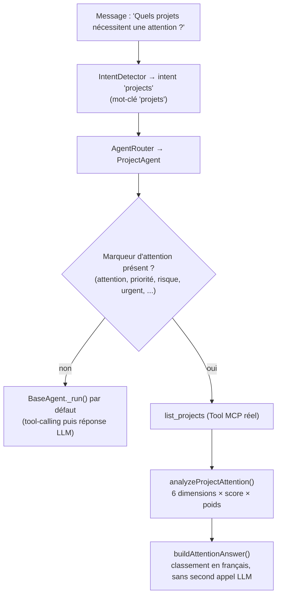

# Business Reasoning — le Copilot raisonne, il ne se contente pas de répondre

Ce document décrit comment le Copilot répond à « Quels projets nécessitent une attention ? » : pas une liste brute passée telle quelle à un modèle de langage, mais une analyse déterministe à 6 dimensions métier, un score, un classement par priorité — et, pour chaque projet signalé, la ou les raisons EXACTES qui l'ont fait remonter. Point d'entrée : `analyzeProjectAttention(projects)` (`reasoning/projectAttentionAnalyzer.js`), mis en mots par `buildAttentionAnswer()` (`reasoning/attentionAnswerBuilder.js`), déclenché depuis `agents/projectAgent.js`.

## Où ça se déclenche

`ProjectAgent` (seul Agent qui gère l'intention `"projects"`, voir `orchestrator/intentCatalog.js`) redéfinit `_run()` : si le message contient un marqueur d'attention/priorité/risque (`ATTENTION_MARKERS` — "attention", "prioritaire", "priorité", "risque", "urgent", "surveiller", ...), il court-circuite le chemin tool-calling-puis-LLM habituel et exécute ce raisonnement à la place. Sinon, comportement inchangé (`BaseAgent._run()` par défaut).

**Pourquoi pas un nouveau mot-clé dans `intentCatalog.js` ?** "attention" est un mot bien trop générique pour servir de mot-clé de ROUTAGE global (il apparaîtrait dans des messages sans rapport avec les projets). Le signal reste donc scopé à l'intérieur de `ProjectAgent`, qui n'est de toute façon invoqué qu'une fois l'intention `"projects"` déjà confirmée par un mot-clé fort ("projet(s)", "retard", "étape", ...). Limite assumée : une formulation qui ne mentionne jamais "projet" (ex. "Quels dossiers ont besoin d'attention ?") pourrait ne jamais être routée vers `ProjectAgent` — une limite du routage lexical existant (`IntentDetector`), pas de ce mécanisme.

## Les 6 dimensions — règles exactes

Chaque dimension calcule une **sévérité** de 0 (rien à signaler) à 3 (signal fort), à partir de champs RÉELS du modèle `Project`/de la fiche projet renvoyée par `list_projects` (`toProjectCard()`, `modules/kanban/services/kanban.service.js`) — jamais un champ inventé. Le score total d'un projet est `Σ (sévérité × poids)` sur les seules dimensions qui ont déclenché un signal.

| # | Dimension | Poids | Champ(s) source | Règle |
|---|---|---|---|---|
| 1 | **Retard** | 3 | `nextRelanceDate` | En retard si `nextRelanceDate` < aujourd'hui. Sévérité : 1 (1-6 j), 2 (7-29 j), 3 (≥30 j). |
| 2 | **Échéances** | 3 | `dateLimiteIngenieur` | Dépassée : mêmes paliers que Retard. Pas encore dépassée mais dans les 7 prochains jours : sévérité 1 ("approche"). |
| 3 | **Blocages** | 3 | `lastAction.{statut,dateAction,commentaire,actionType}` | La dernière action du projet a un statut ≠ "Terminé"/"Annulé" ET sa `dateAction` est dépassée. Sévérité : mêmes paliers (1-6 / 7-29 / ≥30 j de retard). |
| 4 | **Pipeline** | 2 | `pipelineStageId`, `stage.{isWonStage,isLostStage,name}`, `pourcentageReussite`, `createdAt` | Aucune étape assignée → sévérité 2 fixe. Étape gagnée/perdue → 0 (clos). Sinon, si l'avancement (`pourcentageReussite`) est < 30 % : sévérité selon l'ancienneté du projet — 1 (60-119 j), 2 (120-179 j), 3 (≥180 j). |
| 5 | **Activité** | 2 | `updatedAt` | Aucune mise à jour depuis : 1 (14-29 j), 2 (30-59 j), 3 (≥60 j). |
| 6 | **Budget** | 1 | `montantMarche`, `pourcentageReussite` | `montantMarche` absent → sévérité 1 ("budget non défini"). `montantMarche` ≥ 100 000 ET avancement < 30 % → sévérité 2 ("budget élevé, avancement faible"). |

Tous les seuils ci-dessus sont des constantes nommées dans `DEFAULT_BUSINESS_RULES` (`projectAttentionAnalyzer.js`) — configurables en passant un objet `rules` personnalisé à `analyzeProjectAttention(projects, { rules })`, jamais câblés en dur dans la logique de calcul.

## Classement par priorité

Le score total (`Σ sévérité × poids`, max théorique 3×(3+3+3+2+2+1) = 42) est classé en 4 bandes, la première atteinte (dans l'ordre décroissant) l'emporte :

| Priorité | Score minimum |
|---|---|
| `critique` | ≥ 20 |
| `elevee` | ≥ 10 |
| `moyenne` | ≥ 4 |
| `faible` | ≥ 0 (repli) |

`analyzeProjectAttention()` renvoie TOUS les projets (pas seulement ceux signalés), triés par score décroissant — c'est `buildAttentionAnswer()` qui ne met en avant que ceux dont la priorité n'est pas `"faible"` (les 5 premiers par défaut, avec un décompte du reste).

## Exemple travaillé

Un projet avec :
- `nextRelanceDate` il y a 10 jours → **Retard**, sévérité 2 (contribution 6)
- `dateLimiteIngenieur` il y a 40 jours → **Échéance**, sévérité 3 (contribution 9)
- `pourcentageReussite: 15`, créé il y a 90 jours, étape ouverte → **Pipeline**, sévérité 1 (contribution 2)

Score total = 6 + 9 + 2 = **17** → priorité **`elevee`** (≥ 10, < 20). La réponse cite les 3 raisons exactes, dans l'ordre de contribution décroissante (Échéance, Retard, Pipeline).

## Ce qui n'a pas été fait (délibérément) — et pourquoi

- **Budget — limite assumée** : `Project` ne porte AUCUN champ "montant dépensé/réel", seulement `montantMarche` (montant contractuel). Il est donc structurellement impossible de calculer un vrai dépassement budgétaire aujourd'hui. La dimension Budget reste volontairement le poids le plus faible (1, contre 3 pour Retard/Échéance/Blocage) et se limite à deux signaux honnêtes : budget non renseigné, ou gros engagement financier avec avancement faible (un proxy, pas une mesure directe).
- **Pipeline — proxy, pas une mesure directe du temps réellement passé dans l'étape courante** : aucun horodatage "entrée dans l'étape actuelle" n'existe sur `Project` (un `ProjectActivity` de type `stage_change` existe bien à chaque changement d'étape, mais l'exploiter aurait exigé une nouvelle requête corrélée dans `project.repository.js`, hors périmètre de cette passe). Le proxy retenu (ancienneté du projet + avancement faible) est documenté comme tel, pas présenté comme une mesure exacte.
- **Pas de résolution multi-projets liés** : chaque projet est noté indépendamment ; aucune dépendance entre projets (ex. un projet bloqué qui en bloque un autre) n'est modélisée.
- **Pas d'apprentissage / pas de LLM dans le calcul** : entièrement à base de règles, cohérent avec la philosophie « aucun fournisseur LLM requis pour être testable » du reste du kernel.

## Un vrai gap comblé au passage

`toProjectCard()` (et donc le Tool `list_projects`) n'exposait PAS `dateLimiteIngenieur` avant cette passe, alors que ce champ existe sur `Project` depuis le début — sans lui, la dimension Échéances aurait été impossible à calculer à partir des données réellement accessibles au Copilot. Ajouté en un champ additif (`project.repository.js::LIST_ATTRIBUTES`, `kanban.service.js::toProjectCard()`) — même forme, mêmes clients existants (Kanban), une clé de plus dans la réponse.

## Vérifier la cohérence des données (`dataCoherenceChecker.js`)

Distinct de `ProjectAttentionAnalyzer` : l'un évalue l'URGENCE métier (le projet a-t-il besoin d'attention MAINTENANT ?), l'autre la FIABILITÉ des données sous-jacentes (peut-on FAIRE CONFIANCE à ce qui a été utilisé pour répondre ?). `reasoning/dataCoherenceChecker.js::checkProjectsCoherence(projects)` signale, pour chaque projet, deux catégories de problèmes — jamais un avertissement fabriqué :

1. **Fiche incomplète** — réutilise `completionRate`/`missingFields`, DÉJÀ calculés par `computeCompletion()` (`modules/projects/utils/project.completion.js`) et déjà présents dans chaque fiche projet (`toProjectCard()` les inclut via `...computeCompletion(p)`) — un signal réel qui existait avant cette passe mais n'était jamais consommé côté IA. Seuil par défaut : `completionRate < 60`.
2. **Incohérence logique** — deux champs déjà présents qui se contredisent : une étape marquée "gagnée" (`stage.isWonStage`) avec un avancement (`pourcentageReussite`) inférieur à 100 % ; un montant marché renseigné (`montantMarche`) mais aucun avancement jamais suivi (`pourcentageReussite: null`).

Câblé dans `ProjectAgent._runAttentionAnalysis()` (même chemin que Business Reasoning et Smart Suggestions), exposé sous `dataQuality` dans la réponse (`orchestrator/responseBuilder.js`) — un champ SÉPARÉ de `answer`, jamais mélangé à la prose de la réponse (même séparation des responsabilités que `suggestions`/`citations`). Portée assumée : comme pour Smart Suggestions, seul le chemin d'analyse d'attention de `ProjectAgent` le calcule à ce jour — pas encore une question ordinaire ("Montre-moi les projets"), documenté ici plutôt que fabriqué.

## Tests

- `test/ai.reasoning.projectAttentionAnalyzer.test.js` : chacune des 6 dimensions isolément (signal déclenché/non déclenché, paliers de sévérité, bornes exactes), le calcul du score total et son classement en priorité (bornes exactes des 4 bandes), le tri par score décroissant, et l'exemple travaillé ci-dessus.
- `test/ai.reasoning.attentionAnswerBuilder.test.js` : mise en mots (aucun projet signalé, un projet, plusieurs projets, troncature au-delà de `topN`).
- `test/ai.reasoning.dataCoherenceChecker.test.js` : fiche incomplète (seuil configurable, bornes exactes), chacune des 2 incohérences logiques isolément (déclenchée/non déclenchée), agrégation sur une liste (un élément par projet effectivement signalé, jamais un élément vide).
- `test/ai.agents.projectAgent.test.js` : déclenchement du chemin de raisonnement uniquement sur un marqueur d'attention (jamais sur une question `list_projects` ordinaire), appel réel de `list_projects` via le Tool injecté (jamais un accès direct au service CRM — vérifié aussi par `test/ai.agents.policy.test.js`), non-régression du comportement par défaut (`super._run()`) pour toute autre question, et `dataQuality` calculé indépendamment de `suggestions`.
